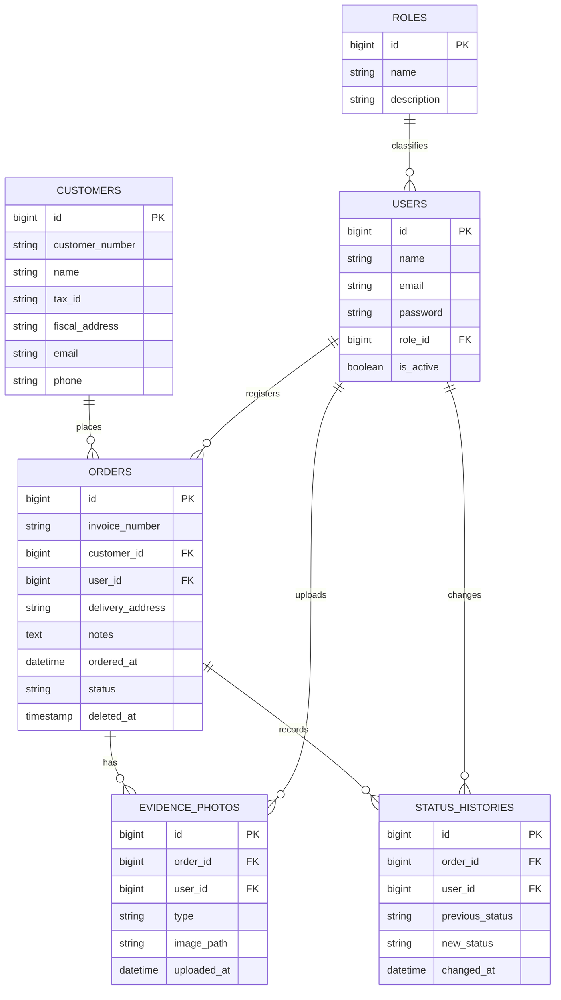

# Halcón — Order Tracking System

## Project description

**Halcón** is a construction material distributor that needs a web application to automate its internal processes and let its customers follow their orders.

The system has two parts:

- **Public screen for customers:** a customer enters their customer number and invoice number to see the status of their order (*Ordered*, *In process*, *In route* or *Delivered*). When the order is delivered, the photo that proves the delivery is displayed.
- **Administrative dashboard for employees:** the staff logs in according to their department (role):
  - **Admin:** comes by default with the system; registers new users and assigns their roles.
  - **Sales:** takes the customers' orders and registers them in the system.
  - **Purchasing:** buys missing materials from external suppliers.
  - **Warehouse:** prepares the orders, changes their status and reports low or missing stock.
  - **Route:** delivers the orders and uploads the loading and delivery photos.

Orders can be listed and searched by invoice number, customer number, date or status. They can be edited and **deleted logically** (they stay in the database but are hidden), and deleted orders can be listed and restored.

**Technologies:** Laravel 12, PHP 8.2+, MySQL.

## ER Diagram



Notes:

- Every table also has `created_at` and `updated_at` (Laravel `timestamps()`).
- `orders.deleted_at` implements the logical delete with Laravel's `SoftDeletes`.
- `customer_number` and `invoice_number` are unique.
- `evidence_photos.type` is `loading` (photo of the loaded unit) or `delivery` (proof of delivery).

## Repository structure

| Folder | Content |
|---|---|
| `docs/` | Evidence 1 documentation: methodology, BPMN, use case, class and activity diagrams, and the first ER diagram. |
| `halcon/` | Laravel project: models, relationships, migrations, seeders, factories, API controllers and tests. |
| `postman/` | Postman collection with every endpoint of the API (Evidence 2). |

## Installation

Requirements: PHP 8.2+, Composer and MySQL.

```bash
git clone https://github.com/frangmt046-lgtm/Evidencia1AplicacionesWeb.git
cd Evidencia1AplicacionesWeb/halcon
composer install
cp .env.example .env
php artisan key:generate
```

Create a MySQL database called `halcon` and set the connection in `.env`:

```env
DB_CONNECTION=mysql
DB_HOST=127.0.0.1
DB_PORT=3306
DB_DATABASE=halcon
DB_USERNAME=root
DB_PASSWORD=your_password
```

Create the tables with the test data and start the API:

```bash
php artisan migrate:fresh --seed
php artisan serve
```

The API is available at `http://127.0.0.1:8000/api`.

## Test data

The seeders and factories create:

- **5 roles:** Admin, Sales, Purchasing, Warehouse and Route (`RoleSeeder`).
- **7 users** (`UserSeeder`), all with the password `password`:

  | id | Name | Email | Role | Active |
  |---|---|---|---|---|
  | 1 | Administrator | admin@halcon.com | Admin | yes |
  | 2 | Laura Méndez | sales@halcon.com | Sales | yes |
  | 3 | Jorge Ramírez | warehouse@halcon.com | Warehouse | yes |
  | 4 | Carlos Torres | route@halcon.com | Route | yes |
  | 5 | Ana López | purchasing@halcon.com | Purchasing | yes |
  | 6 | Miguel Herrera | miguel.herrera@halcon.com | Sales | **no** |
  | 7 | Sofía Castillo | sofia.castillo@halcon.com | Route | **no** |

- **20 customers** (`CustomerFactory`).
- **50 orders** (`OrderFactory`) with consecutive invoice numbers (`INV-00001` to `INV-00050`), each with its status history and, when the order is *In route* or *Delivered*, its evidence photos.
- **5 archived orders** (logically deleted): `INV-00005`, `INV-00012`, `INV-00023`, `INV-00038` and `INV-00047`.

## Backend functionality (Evidence 2)

The backend is a JSON REST API built with Laravel. Frontend views, authentication and authorization are not part of this evidence.

- **Controllers** (`halcon/app/Http/Controllers/Api/`): `UserController`, `OrderController` and `CustomerController`.
- **Routes:** `halcon/routes/api.php` (all of them start with `/api`).
- **Logical delete:** orders use `SoftDeletes`; deleting an order only fills `deleted_at`, so it can be listed as archived and restored.
- **Status history:** every time an order is created or changes status, a row is written in `status_histories` with the previous status, the new status and the user who made the change.
- **Business rules:**
  - A new order always starts as *Ordered*. If `invoice_number` is not sent, the next consecutive number (`INV-00051`, ...) is generated.
  - The status moves one step at a time: *Ordered → In process → In route → Delivered*. It cannot go back or skip steps (422).
  - Users are never deleted when they have history; they are **deactivated**. An inactive user cannot register orders or change statuses (422).
- **Errors** are always JSON: `422` validation errors (with an `errors` object), `404` for ids that do not exist or archived orders, `409` when a user with history is deleted.

Send these headers in every request:

```
Accept: application/json
Content-Type: application/json
```

### Users

| Method | Endpoint | Purpose |
|---|---|---|
| GET | `/api/users` | List all users, active **and** inactive, with their role (15 per page). Optional filter `?status=active` or `?status=inactive`. |
| GET | `/api/users/{id}` | Retrieve one user with its role. |
| POST | `/api/users` | Create a user and assign its role. Returns `201`. |
| PUT / PATCH | `/api/users/{id}` | Update the basic information of a user (name, email, password, role). |
| PATCH | `/api/users/{id}/deactivate` | Change the status of a user to inactive (`is_active = false`). |
| PATCH | `/api/users/{id}/activate` | Change the status of a user back to active. |
| DELETE | `/api/users/{id}` | Physically delete a user **without** history (`204`); returns `409` if it has orders, photos or status changes. |

Body for `POST /api/users` (`role_id`: 1 Admin, 2 Sales, 3 Purchasing, 4 Warehouse, 5 Route):

```json
{
    "name": "Pedro Gómez",
    "email": "pedro.gomez@halcon.com",
    "password": "password123",
    "password_confirmation": "password123",
    "role_id": 2
}
```

Body for `PUT /api/users/{id}` (with `PATCH` only the fields that change are sent):

```json
{
    "name": "Pedro Gómez Ruiz",
    "email": "pedro.gomez@halcon.com",
    "role_id": 2
}
```

### Orders

| Method | Endpoint | Purpose |
|---|---|---|
| GET | `/api/orders` | List active orders from **newest to oldest** (15 per page). Optional filters: `?status=In route`, `?customer_number=CUS-12345`, `?date=2026-10-28`. |
| GET | `/api/orders/{id}` | Retrieve one order with its customer, the user who registered it, its status history and its evidence photos. |
| GET | `/api/orders/invoice/{invoice}` | Search an order by its invoice number, e.g. `/api/orders/invoice/INV-00001`. |
| POST | `/api/orders` | Create an order (status *Ordered*). Returns `201`. |
| PUT / PATCH | `/api/orders/{id}` | Update an order (customer, address, notes, date, invoice). It can also change the status by sending `status` and `changed_by`. |
| PATCH | `/api/orders/{id}/status` | Change the status of an order and record it in the status history. |
| DELETE | `/api/orders/{id}` | Logically delete (archive) an order. |
| GET | `/api/orders/archived` | List the archived orders. |
| PATCH | `/api/orders/{id}/restore` | Restore an archived order. |

Body for `POST /api/orders` (`user_id` is the active user who registers the order; `invoice_number` and `ordered_at` are optional):

```json
{
    "customer_id": 1,
    "user_id": 2,
    "delivery_address": "Av. Juárez 123, Guadalajara, Jal.",
    "notes": "Deliver in the morning"
}
```

Body for `PATCH /api/orders/{id}`:

```json
{
    "delivery_address": "Av. Vallarta 4500, Zapopan, Jal.",
    "notes": "Call the customer before delivering"
}
```

Body for `PATCH /api/orders/{id}/status` (`changed_by` is the active user who makes the change):

```json
{
    "status": "In process",
    "changed_by": 3
}
```

### Customers (support)

Needed to know which `customer_id` to send when an order is created.

| Method | Endpoint | Purpose |
|---|---|---|
| GET | `/api/customers` | List customers (15 per page). |
| GET | `/api/customers/{id}` | Retrieve one customer with its number of orders. |
| POST | `/api/customers` | Create a customer. Returns `201`. |

## Testing the API

### Postman

Import `postman/Halcon_API.postman_collection.json` in Postman. The collection has the variable `base_url` (`http://127.0.0.1:8000/api`) and four folders:

- **Demo flow (video):** create a user → create an order with that user → get it → update it and change its status → get it again → archive it → check it is archived. Each request saves the ids it creates (`user_id`, `order_id`, `invoice_number`) so the next request uses them.
- **Users**, **Orders** and **Customers:** one request for each endpoint.

### Automated tests

```bash
cd halcon
php artisan test --filter=ApiTest
```

`tests/Feature/UserApiTest.php` and `tests/Feature/OrderApiTest.php` check every endpoint and business rule using an in-memory SQLite database.
